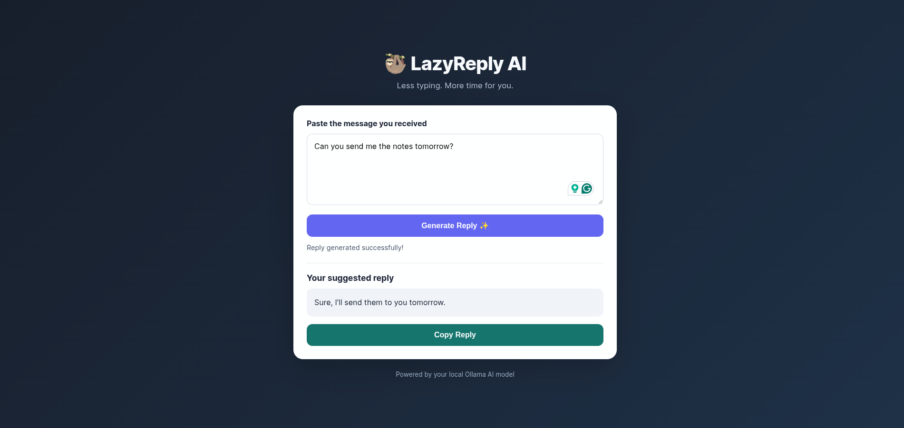

# LazyReply AI 🦥

**Less typing. More time for you.**


LazyReply AI is a simple web application that uses a local AI model to generate short, polite replies to messages.

## Features

- Generate polite replies to messages.
- Copy generated replies with one click.
- Simple, responsive web interface.
- Uses Ollama to run an AI model locally.

## Technologies Used

- Python
- Flask
- HTML and CSS
- JavaScript
- Ollama
- Qwen2.5-Coder 3B

## Prerequisites

- Python 3
- Ollama
- The `qwen2.5-coder:3b` model

## Installation

1. Clone or download this repository.
2. Open a terminal in the project folder.
3. Create and activate a virtual environment.

For Bash:

```bash
python -m venv venv
source venv/bin/activate
```

For Fish shell:

```fish
python -m venv venv
source venv/bin/activate.fish
```

4. Install dependencies:

```bash
pip install -r requirements.txt
```

5. Make sure Ollama is running and download the model if needed:

```bash
ollama pull qwen2.5-coder:3b
```

6. Start the application:

```bash
python app.py
```

7. Open `http://127.0.0.1:5001` in your browser.

## How to Use

1. Paste the message you received.
2. Click **Generate Reply**.
3. Read the suggested reply.
4. Click **Copy Reply** to copy it.

## Privacy

Messages are sent to the locally running Ollama service configured by the application. Avoid entering sensitive information unless you understand your local setup.

## License

This project is open source. A license has not yet been selected.
